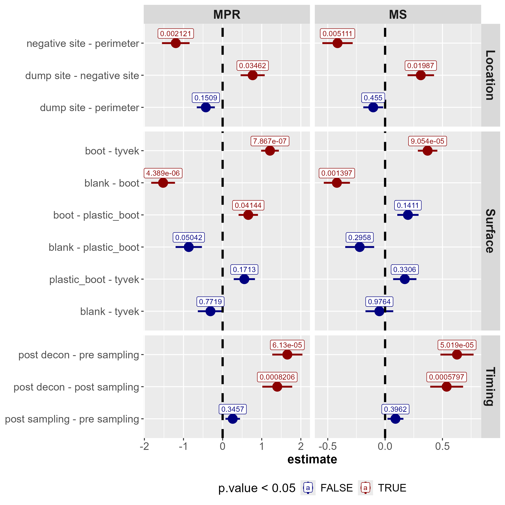
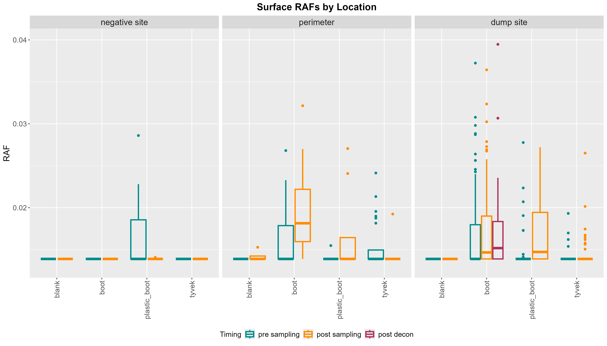
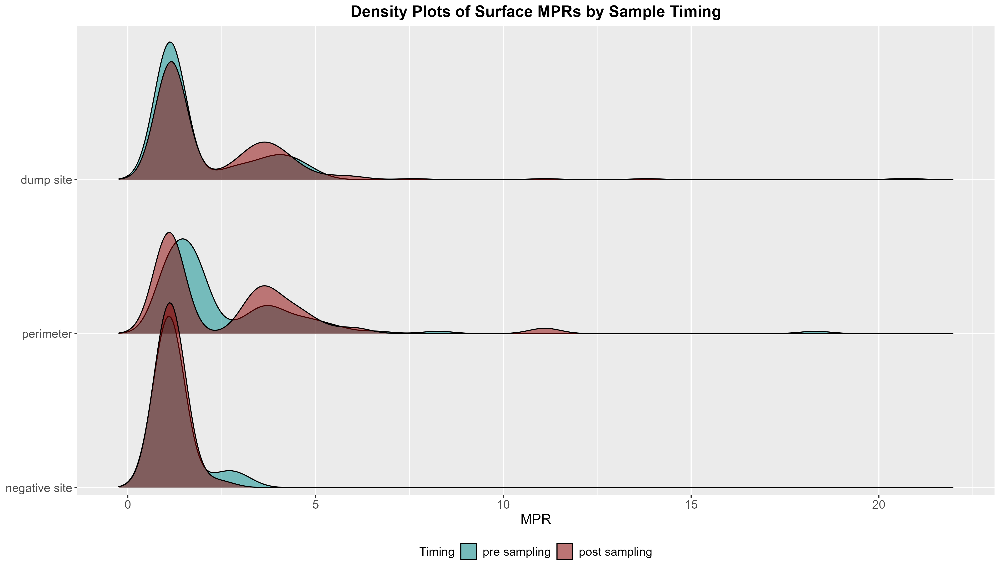

```{r Initialize, echo=FALSE, message=FALSE}
library(tidyverse)
library(kableExtra)

results <- read.csv("data/results.csv")
```

# Beltrami PPE Swabs

## Methodology
PPE swabs were run by RT-QuIC at 42$^\circ$C for 72 hours. Maxpoint ratios and max slope values were used as predictors in a generalized linear model for the following factors:

1.    Location (dump site, negative site, perimeter)
2.    Timing (pre/post-sampling and post-decon)
3.    Surface (the surface that was swabbed). 

Least-square means were calculated, and pairwise comparisons were performed for each factor. Contrasts with a p-value \leq{}0.05 were considered significant.

\newpage

## Results

```{r Results Table, echo=FALSE}
results <- results %>%
  select(Factor, contrast, estimate, std.error, p.value, metric) %>%
  rename_at(c(1:4, 6), str_to_title) %>%
  mutate(
    Factor = factor(Factor, levels = c("Location", "Timing", "Surface")),
    Result = ifelse(
      p.value <= 0.001, 
      "***", 
      ifelse(
        p.value <= 0.01, 
        "**", 
        ifelse(
          p.value <= 0.05, 
          "*", 
          "ns"
        )
      )
    ),
    Result = factor(Result, levels = c("***", "**", "*", "ns"))
  ) %>%
  arrange(Factor, p.value) %>%
  mutate_if(is.numeric, ~signif(., 4))
```

```{r MPR table, echo=FALSE}
# MPR table
results %>%
  filter(Metric == "MPR") %>%
  mutate_all(
    ~ cell_spec(
      .,
      background = ifelse(Result != "ns", "red", "white"),
      color = ifelse(Result != "ns", "white", "black")
    )
  ) %>%
  kable(
    booktabs = TRUE,
    linesep = "",
    format = "latex",
    escape = FALSE,
    align = "c",
    caption = "Maxpoint ratio results. Significant contrasts are highlighted in red.",
    label = "tbl-mpr"
    # longtable = TRUE
  ) %>%
  kable_styling(latex_options = c("hold_position", "repeat_header", "scale_down")) %>%
  kable_paper(full_width = F)
```

```{r, echo=FALSE}
# MS table
results %>%
  filter(Metric == "MS") %>%
  mutate_all(
    ~ cell_spec(
      .,
      background = ifelse(Result != "ns", "red", "white"),
      color = ifelse(Result != "ns", "white", "black")
    )
  ) %>%
  kable(
    booktabs = TRUE,
    linesep = "",
    format = "latex",
    escape = FALSE,
    align = "c",
    caption = "Max slope results. Significant contrasts are highlighted in red.",
    label = "tbl-ms"
    # longtable = TRUE
  ) %>%
  kable_styling(latex_options = c("hold_position", "repeat_header", "scale_down")) %>%
  kable_paper(full_width = F)
```





